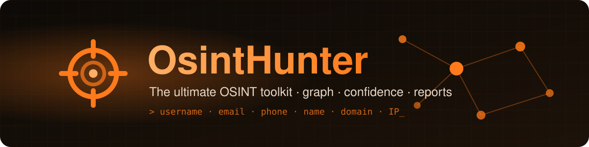
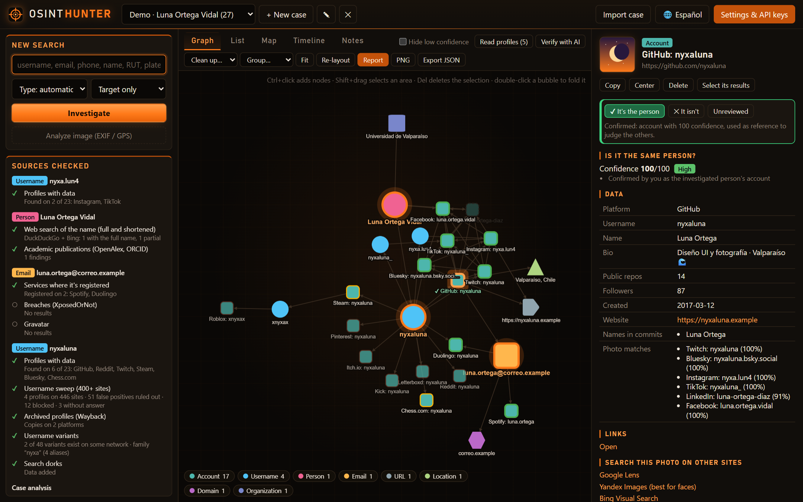
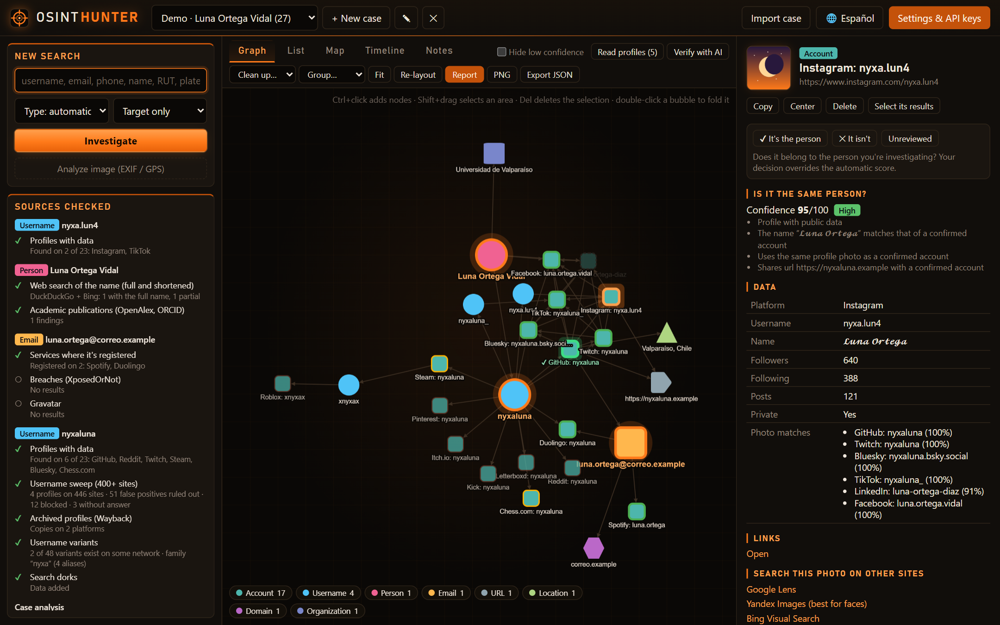
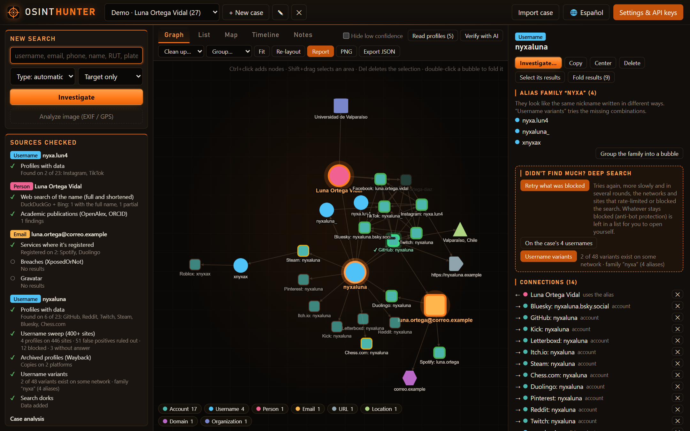
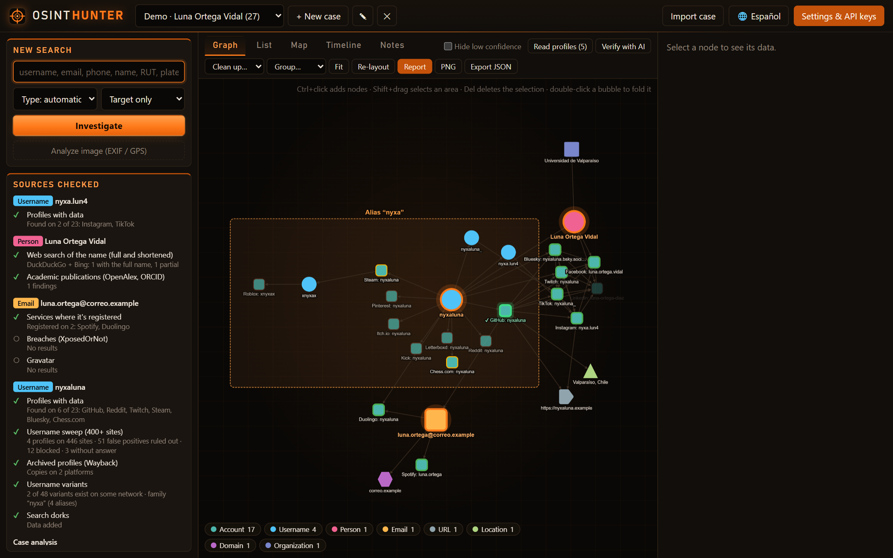
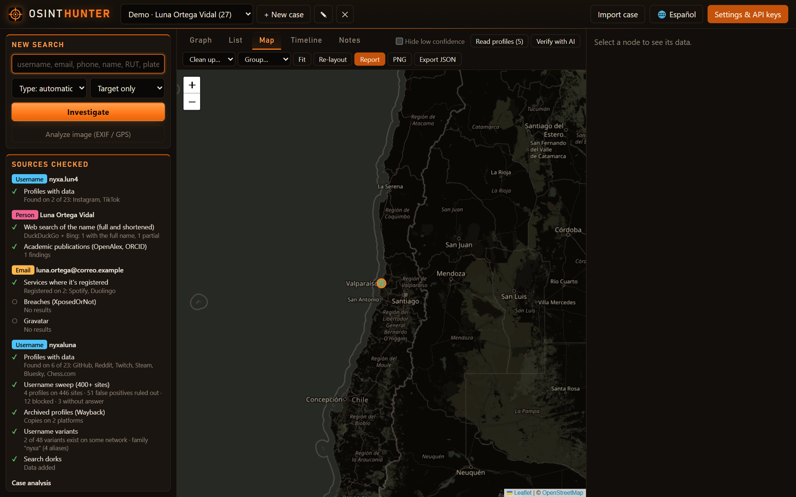
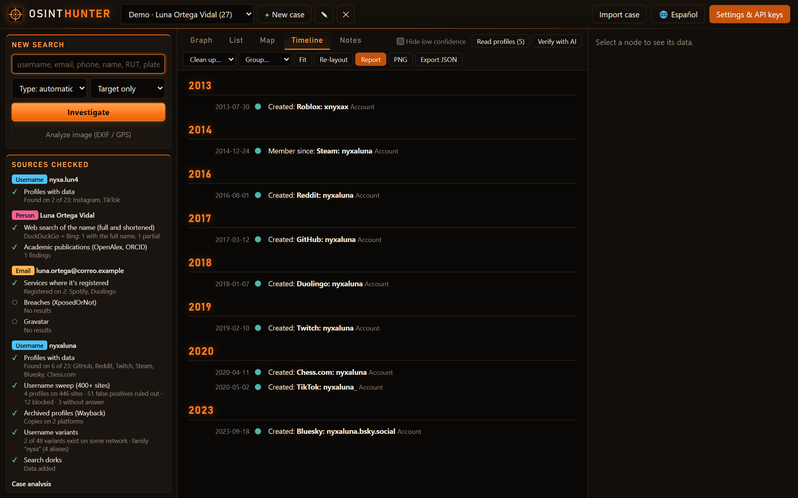
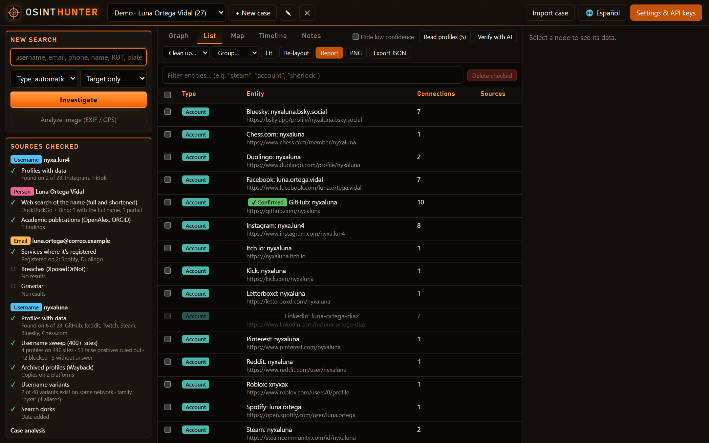
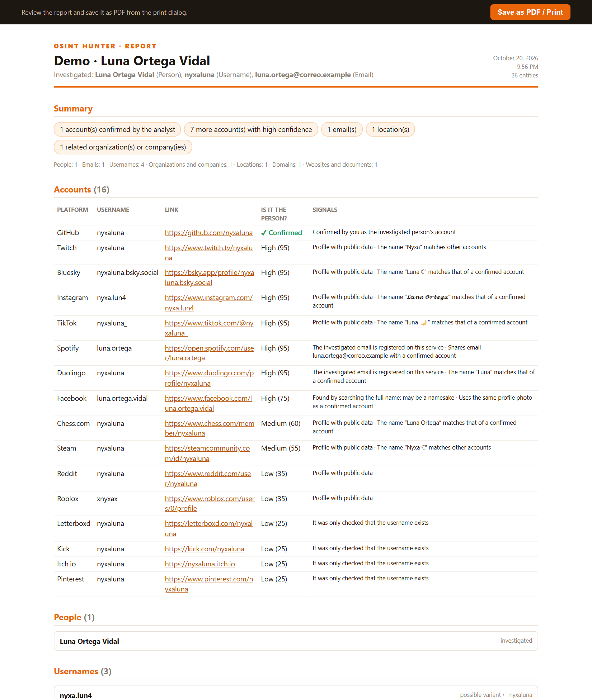
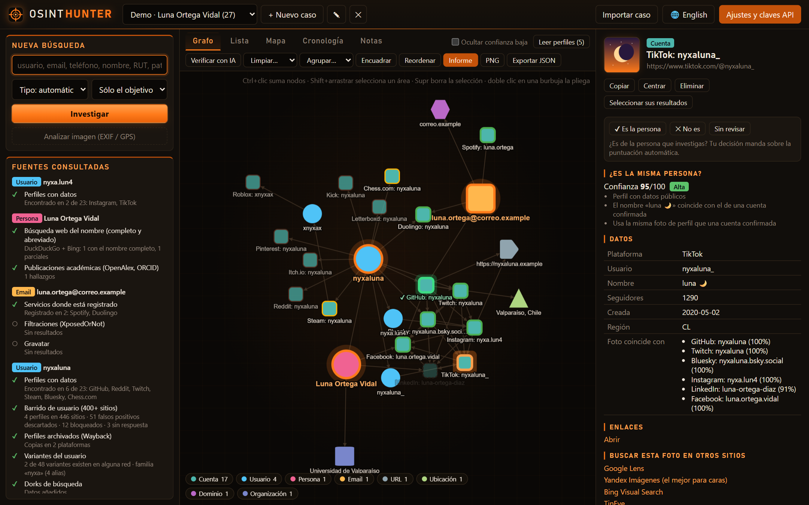

<div align="center">


## kg6zjl-personal fork

Environment variables (optional; override settings UI / `settings.json`):

| Variable | Values | Default (this fork) |
|---|---|---|
| `OSINT_LANG` | `en` \| `es` | `en` |
| `OSINT_ENABLE_CHILE` | `true`/`false` | `false` — skips Chile modules (RUT, plate, NIC Chile, InfoProbidad, …) |

When set, env wins over the settings file (`lang_locked` / `chile_locked` in `/api/settings`).
UI language toggle is wired through `i18n.js` + `/config.js` bootstrap.



**🇬🇧 English** · [🇪🇸 Español](README.es.md)

<br>

[](https://github.com/letox4/OsintHunter/releases/latest)
[](https://github.com/letox4/OsintHunter/releases)
[](https://www.python.org/)
[](https://fastapi.tiangolo.com/)
[](LICENSE)

[](#-modules)
[](#-modules)
[](#-optional-api-keys)
[](#)
[](#-privacy)

### ${\color{#ff7a1a}\textsf{Find.\ Connect.\ Confirm.}}$

**Desktop OSINT platform** that starts from a username, email, phone, name, domain, IP or Chilean RUT<br>
and builds an **investigation graph** with confidence scoring, a map, a timeline and a report.

[**⬇️ Download .exe**](https://github.com/letox4/OsintHunter/releases/latest) ·
[**🚀 Quick start**](#-quick-start) ·
[**🧩 Modules**](#-modules) ·
[**📸 Screenshots**](#-screenshots)

</div>

---

<div align="center">

<sub><i>Graph of a demo case. Every screenshot uses a <b>fictional</b> person and <code>.example</code> domains.</i></sub>
</div>

## ✨ What makes it different

${\color{#ff7a1a}\textsf{From\ a\ single\ clue\ to\ a\ full\ profile,\ with\ evidence\ for\ every\ link.}}$

| | |
|---|---|
| 🕸️ **Live graph** | Every finding is a node and relationships draw themselves. Group into bubbles by type, platform or **alias family**. |
| 🎯 **Confidence scoring** | Every account gets a 0-100 score from name, photo, location and cross-links. Tells the real person apart from **namesakes**. |
| 🧬 **Alias families** | Detects that `nyxaluna`, `nyxa.lun4` and `xnyxax` share a root (leet, repeated letters, prefixes) and tries the missing variants. |
| 🔁 **Smart retries** | When Instagram, TikTok or a WAF rate-limits you, it retries with pauses and leaves a checklist to verify by hand. |
| 🇨🇱 **Chilean sources** | RUT, license plates, NIC Chile, InfoProbidad, companies by RUT and university theses. |
| 🗺️ **Map & timeline** | Geocodes locations and orders account creations, commits, breaches and archives chronologically. |
| 📄 **Report** | Exports the case to HTML/PDF, ready to hand over. |
| 🤖 **Optional AI** | Case summary and analysis with local Ollama or any OpenAI-compatible provider. |
| 🔒 **Fully local** | A single `.exe` with a SQLite database next to it. Nothing leaves your machine except the queries to the sources. |

## 📸 Screenshots

<table>
  <tr>
    <td width="50%"><br><b>🎯 Confidence</b> · why an account is (or isn't) the person</td>
    <td width="50%"><br><b>🧬 Alias families</b> · shared root and tested variants</td>
  </tr>
  <tr>
    <td><br><b>🫧 Bubbles</b> · the graph grouped by alias family</td>
    <td><br><b>🗺️ Map</b> · geocoded locations</td>
  </tr>
  <tr>
    <td><br><b>🕒 Timeline</b> · the digital history in order</td>
    <td><br><b>📋 List</b> · every entity, with filters</td>
  </tr>
  <tr>
    <td><br><b>📄 Report</b> · exportable to HTML/PDF</td>
    <td><br><b>🌐 Bilingual</b> · one click switches the UI to Spanish</td>
  </tr>
</table>

## 🚀 Quick start

### Option 1 · Executable (Windows)

1. Download **`OsintHunter.exe`** from [Releases](https://github.com/letox4/OsintHunter/releases/latest).
2. Put it in any folder and run it. Your browser opens at `http://127.0.0.1:8787`.
3. Click **English** in the top bar, create a case, type a username / email / phone / name and hit **Investigate**.

> [!NOTE]
> Data is stored in a `data` folder next to the `.exe`. Windows SmartScreen may warn you because the executable isn't signed: *More info → Run anyway*.

### Option 2 · From source

```bash
git clone https://github.com/letox4/OsintHunter.git
cd OsintHunter
start.bat            # creates the venv, installs dependencies and starts
```

On Linux / macOS:

```bash
python3 -m venv .venv && source .venv/bin/activate
pip install -r requirements.txt
python -m app
```

### Build your own .exe

```bash
build_exe.bat        # output goes to dist\OsintHunter.exe
```

## 🧩 Modules

<details open>
<summary><b>49 modules</b> organized by data type</summary>

<br>

| Input | Modules |
|---|---|
| 👤 **Username** | Detailed profiles (Instagram, TikTok, GitHub, Reddit…), sweep across **400+ sites** (Sherlock database), alias variants and families, blocked-check retries, deep GitHub, Wayback-archived profiles, forum mentions, profile-page reader |
| 📧 **Email** | MX validation, Gravatar, breaches (XposedOrNot, HIBP), accounts registered on apps, Hunter.io |
| 📱 **Phone** | Carrier, country and line type, Numverify |
| 🧑 **Person** | Web search (DuckDuckGo, Bing, Serper, Brave), dorks, Wikidata, academic publications |
| 🌐 **Domain / URL** | DNS, RDAP/WHOIS, subdomains (crt.sh), website analysis, Wayback, VirusTotal, URLScan, URLhaus |
| 🖥️ **IP** | Geolocation, Shodan InternetDB, reverse DNS, Shodan, AbuseIPDB, GreyNoise |
| 🇨🇱 **Chile** | RUT, license plates, NIC Chile, InfoProbidad / lobby, companies by RUT, theses |
| 📎 **Other** | Document and image metadata (EXIF/GPS), hashes, MalwareBazaar, crypto wallets, Discord invites, Flickr geo |

</details>

## 🔑 Optional API keys

OsintHunter **works without any key**. Add some in *Settings* to unlock more sources:

<details>
<summary>See the 13 integrations</summary>

<br>

| Service | What for |
|---|---|
| Serper.dev / Brave Search | More reliable web search (Google) |
| GitHub token | Raises the limit from 60 to 5000 requests/h |
| Have I Been Pwned | Breaches for an email |
| Hunter.io | Email verification |
| Numverify | Phone data |
| Shodan · AbuseIPDB · GreyNoise | IP reputation |
| VirusTotal · URLScan · abuse.ch | Domain and URL reputation |
| AI provider | AI analysis (not needed with local Ollama) |

</details>

## 🔒 Privacy

- Everything runs on **your machine** (`127.0.0.1`): no middle servers, no telemetry.
- Cases, settings and keys are stored in `data/`, which is excluded from the repository.

## ⚖️ Responsible use

> [!WARNING]
> OsintHunter only queries **public sources**. It is meant for legitimate investigation: cybersecurity, journalism, identity verification, missing-person searches or auditing your own digital footprint.
> **Do not use it to harass, stalk or violate anyone's privacy.** Follow the data-protection laws of your country and each service's terms. The author is not responsible for misuse.

---

<div align="center">

### ${\color{#ff7a1a}\textsf{Made\ by\ letox4}}$

If it helps you, leave a ⭐. It really helps.

<sub>MIT © 2026 letox4</sub>

</div>
