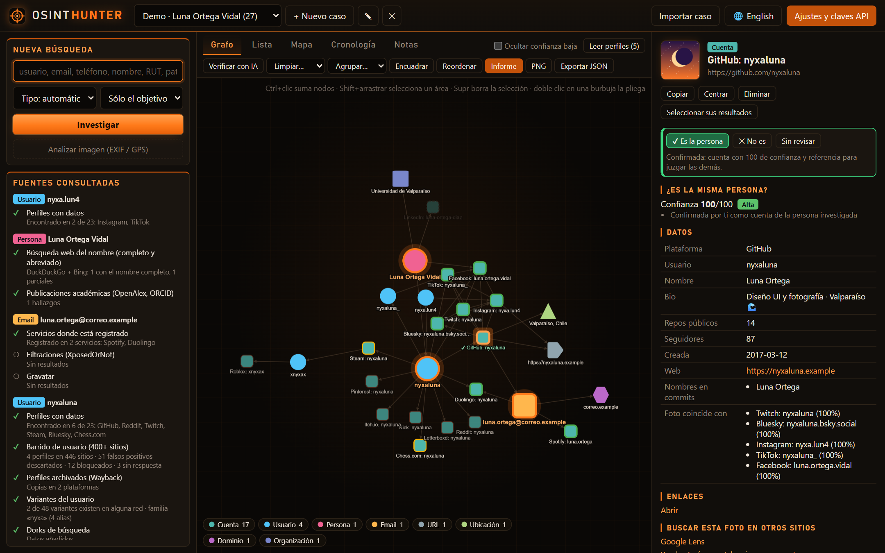
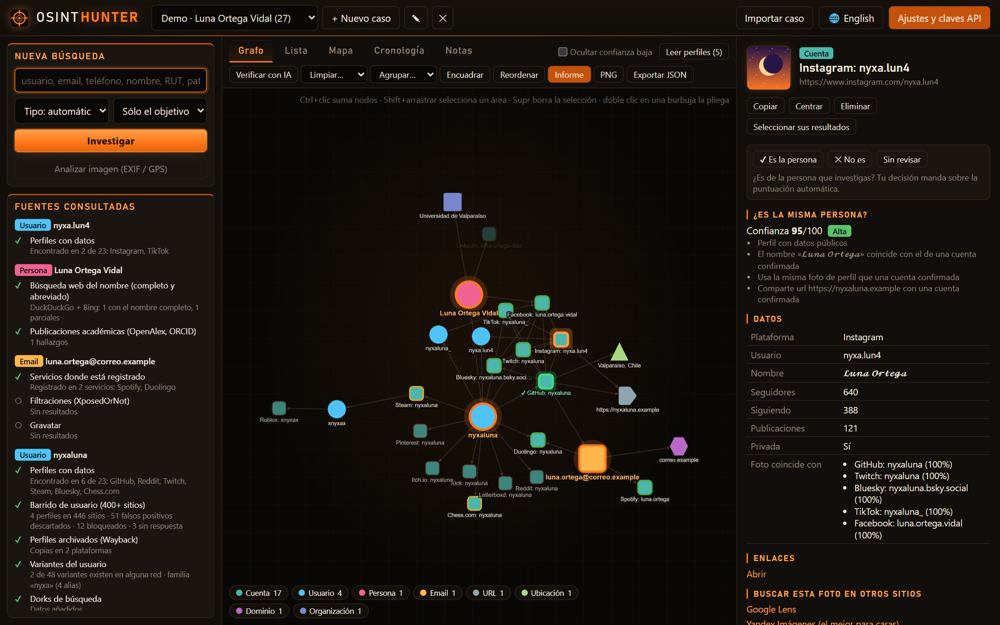
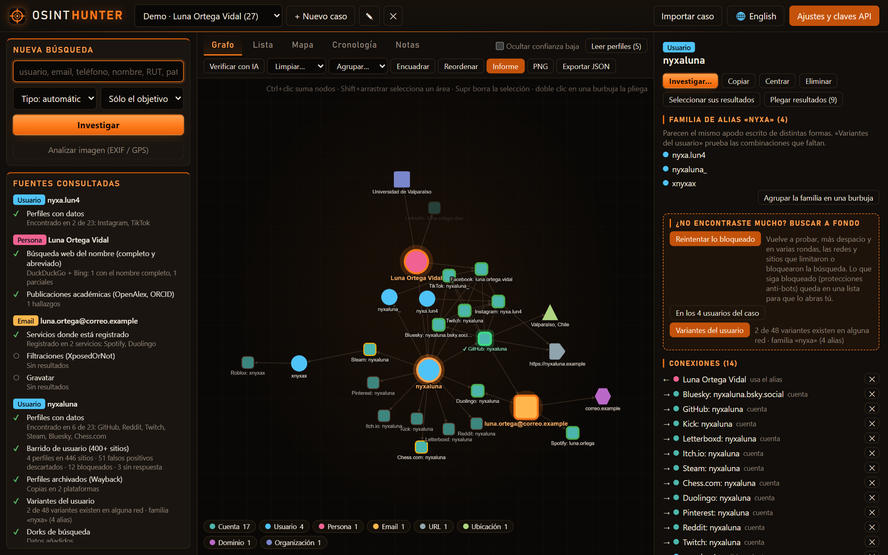
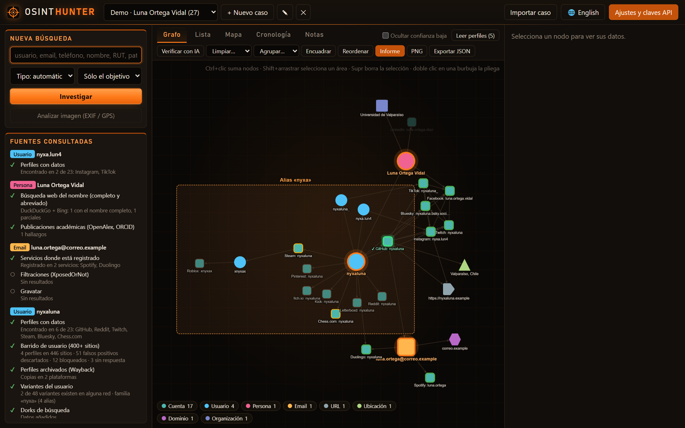
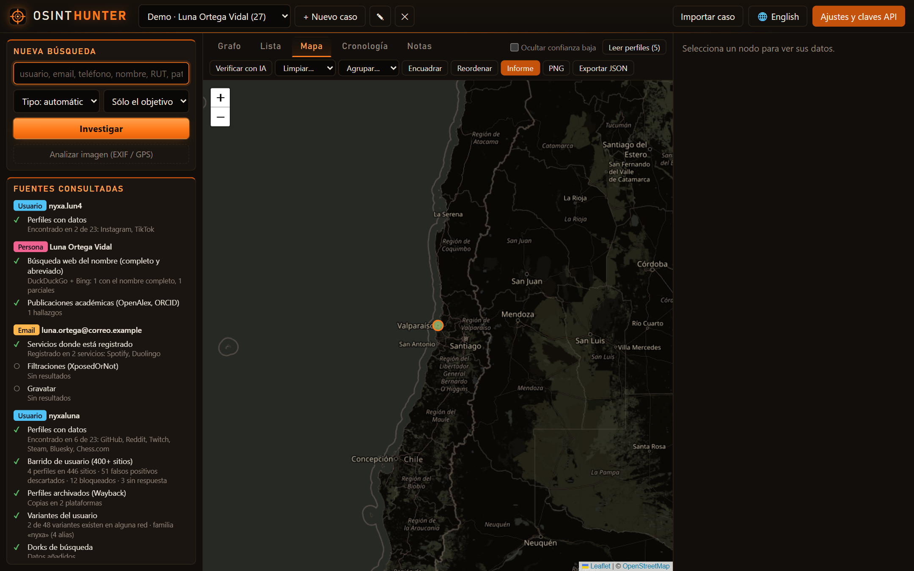
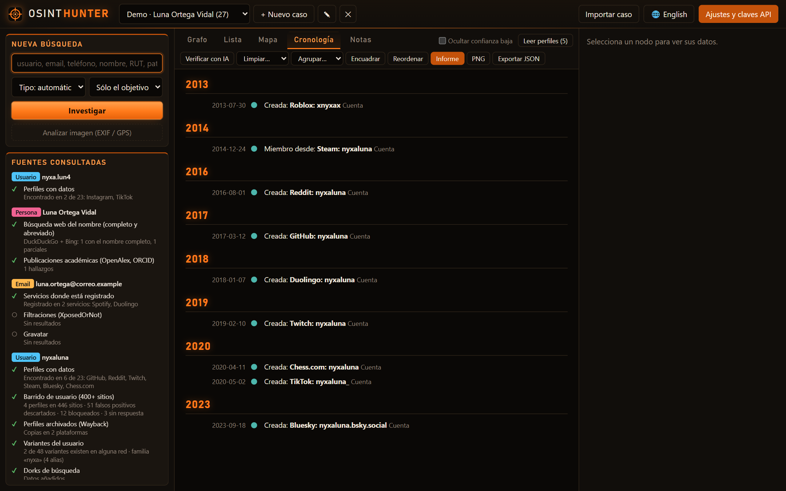
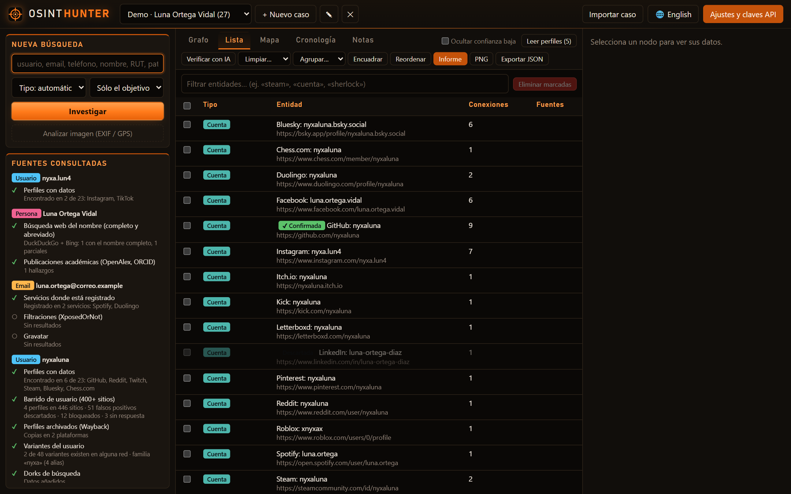
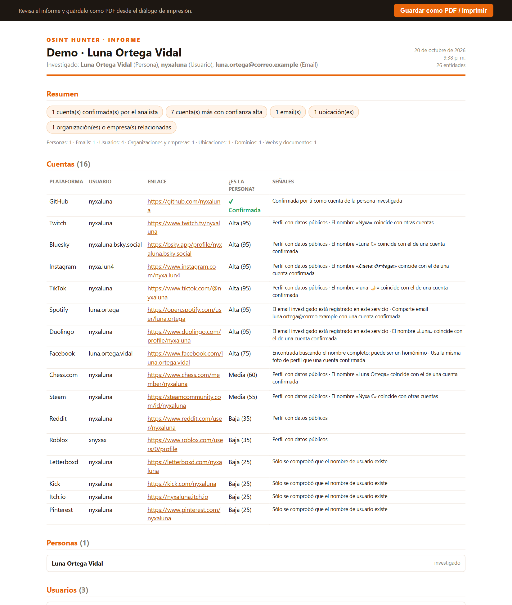
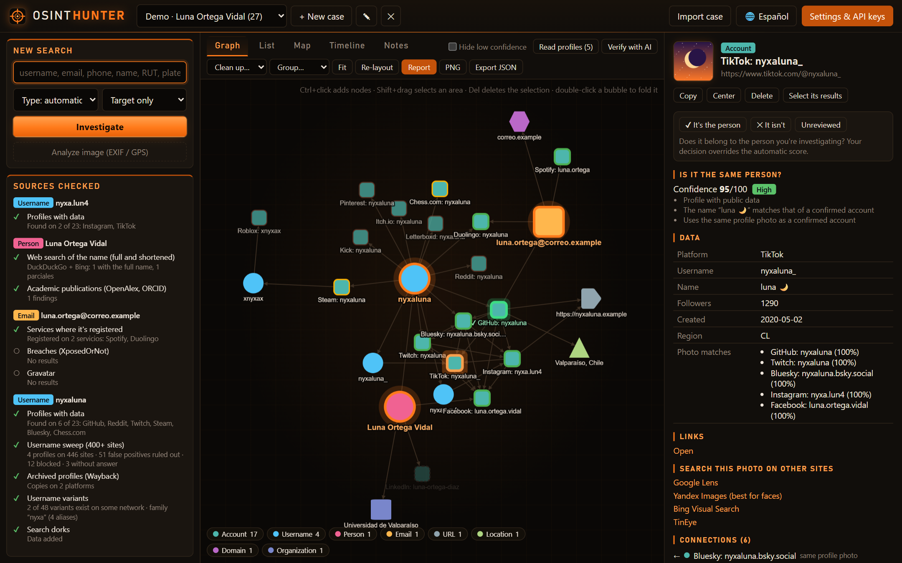

<div align="center">


<br>

[](https://github.com/letox4/OsintHunter/releases/latest)
[](https://github.com/letox4/OsintHunter/releases)
[](https://www.python.org/)
[](https://fastapi.tiangolo.com/)
[](LICENSE)

[](#-módulos)
[](#-módulos)
[](#-claves-de-api-opcionales)
[](#)
[](#-privacidad)

### ${\color{#ff7a1a}\textsf{Encuentra.\ Conecta.\ Confirma.}}$

**Plataforma OSINT de escritorio** que parte de un usuario, email, teléfono, nombre, dominio, IP o RUT<br>
y construye un **grafo de investigación** con puntuación de confianza, mapa, línea de tiempo e informe.

[**⬇️ Descargar .exe**](https://github.com/letox4/OsintHunter/releases/latest) ·
[**🚀 Inicio rápido**](#-inicio-rápido) ·
[**🧩 Módulos**](#-módulos) ·
[**📸 Capturas**](#-capturas) ·
[**🇬🇧 English**](#-english)

</div>

---

<div align="center">

<sub><i>Grafo de un caso de demostración. Todas las capturas usan una persona <b>ficticia</b> y dominios <code>.example</code>.</i></sub>
</div>

## ✨ Qué lo hace distinto

${\color{#ff7a1a}\textsf{De\ un\ solo\ dato\ a\ un\ perfil\ completo,\ con\ pruebas\ de\ cada\ conexión.}}$

| | |
|---|---|
| 🕸️ **Grafo vivo** | Cada hallazgo es un nodo; las relaciones se dibujan solas. Agrupa en burbujas por tipo, plataforma o **familia de alias**. |
| 🎯 **Puntuación de confianza** | Cada cuenta recibe una nota 0-100 según nombre, foto, ubicación y enlaces cruzados. Separa a la persona real de sus **homónimos**. |
| 🧬 **Familias de alias** | Detecta que `nyxaluna`, `nyxa.lun4` y `xnyxax` son la misma raíz (leet, repeticiones, prefijos) y prueba variantes. |
| 🔁 **Reintento inteligente** | Cuando Instagram, TikTok o un WAF bloquean, reintenta con pausas y te deja una lista para comprobar a mano. |
| 🇨🇱 **Fuentes de Chile** | RUT, patentes, NIC Chile, InfoProbidad, empresas por RUT y tesis universitarias. |
| 🗺️ **Mapa y línea de tiempo** | Geocodifica ubicaciones y ordena cronológicamente creaciones de cuentas, commits, filtraciones y archivos. |
| 📄 **Informe** | Exporta el caso a HTML/PDF listo para entregar. |
| 🤖 **IA opcional** | Resumen y análisis del caso con Ollama local o un proveedor compatible con OpenAI. |
| 🔒 **Todo local** | Una sola `.exe`, base de datos SQLite a su lado, nada sale de tu equipo salvo las consultas a las fuentes. |

## 📸 Capturas

<table>
  <tr>
    <td width="50%"><br><b>🎯 Confianza</b> · por qué una cuenta es (o no) la persona</td>
    <td width="50%"><br><b>🧬 Familias de alias</b> · raíz común y variantes probadas</td>
  </tr>
  <tr>
    <td><br><b>🫧 Burbujas</b> · el grafo agrupado por familia de alias</td>
    <td><br><b>🗺️ Mapa</b> · ubicaciones geocodificadas</td>
  </tr>
  <tr>
    <td><br><b>🕒 Línea de tiempo</b> · la historia digital en orden</td>
    <td><br><b>📋 Lista</b> · todas las entidades con filtros</td>
  </tr>
  <tr>
    <td><br><b>📄 Informe</b> · exportable a HTML/PDF</td>
    <td><br><b>🌐 English UI</b> · interfaz bilingüe ES / EN</td>
  </tr>
</table>

## 🚀 Inicio rápido

### Opción 1 · Ejecutable (Windows)

1. Descarga **`OsintHunter.exe`** desde [Releases](https://github.com/letox4/OsintHunter/releases/latest).
2. Ponlo en cualquier carpeta y ábrelo. Se abre el navegador en `http://127.0.0.1:8787`.
3. Crea un caso, escribe un usuario / email / teléfono / nombre y pulsa **Investigar**.

> [!NOTE]
> Los datos se guardan en una carpeta `data` junto al `.exe`. Windows SmartScreen puede avisar porque el ejecutable no está firmado: *Más información → Ejecutar de todas formas*.

### Opción 2 · Desde el código

```bash
git clone https://github.com/letox4/OsintHunter.git
cd OsintHunter
start.bat            # crea el entorno, instala dependencias y arranca
```

En Linux / macOS:

```bash
python3 -m venv .venv && source .venv/bin/activate
pip install -r requirements.txt
python -m app
```

### Generar tu propio .exe

```bash
build_exe.bat        # deja el resultado en dist\OsintHunter.exe
```

## 🧩 Módulos

<details open>
<summary><b>49 módulos</b> organizados por tipo de dato</summary>

<br>

| Entrada | Módulos |
|---|---|
| 👤 **Usuario** | Perfiles detallados (Instagram, TikTok, GitHub, Reddit…), barrido en **400+ sitios** (base de Sherlock), variantes y familias de alias, reintento de bloqueados, GitHub a fondo, perfiles archivados en Wayback, menciones en foros, lectura de la página del perfil |
| 📧 **Email** | Validación MX, Gravatar, filtraciones (XposedOrNot, HIBP), cuentas registradas en apps, Hunter.io |
| 📱 **Teléfono** | Operador, país y tipo de línea, Numverify |
| 🧑 **Persona** | Búsqueda web (DuckDuckGo, Bing, Serper, Brave), dorks, Wikidata, publicaciones académicas |
| 🌐 **Dominio / URL** | DNS, RDAP/WHOIS, subdominios (crt.sh), análisis del sitio, Wayback, VirusTotal, URLScan, URLhaus |
| 🖥️ **IP** | Geolocalización, Shodan InternetDB, DNS inverso, Shodan, AbuseIPDB, GreyNoise |
| 🇨🇱 **Chile** | RUT, patentes, NIC Chile, InfoProbidad / lobby, empresas por RUT, tesis |
| 📎 **Otros** | Metadatos de documentos e imágenes (EXIF/GPS), hashes, MalwareBazaar, carteras cripto, invitaciones de Discord, Flickr geo |

</details>

## 🔑 Claves de API opcionales

OsintHunter **funciona sin ninguna clave**. Si añades alguna en *Ajustes*, se activan más fuentes:

<details>
<summary>Ver las 13 integraciones</summary>

<br>

| Servicio | Para qué |
|---|---|
| Serper.dev / Brave Search | Búsqueda web más fiable (Google) |
| GitHub token | Sube el límite de 60 a 5000 peticiones/h |
| Have I Been Pwned | Filtraciones de un email |
| Hunter.io | Verificación de emails |
| Numverify | Datos del teléfono |
| Shodan · AbuseIPDB · GreyNoise | Reputación de IPs |
| VirusTotal · URLScan · abuse.ch | Reputación de dominios y URLs |
| Proveedor de IA | Análisis con IA (no hace falta con Ollama local) |

</details>

## 🔒 Privacidad

- Todo se ejecuta en **tu equipo** (`127.0.0.1`); no hay servidores intermedios ni telemetría.
- Los casos, ajustes y claves se guardan en `data/`, que está excluido del repositorio.

## ⚖️ Uso responsable

> [!WARNING]
> OsintHunter consulta **solo fuentes públicas**. Está pensado para investigación legítima: ciberseguridad, periodismo, verificación de identidad, búsqueda de personas desaparecidas o auditar tu propia huella digital.
> **No lo uses para acosar, acechar ni vulnerar la privacidad de nadie.** Respeta las leyes de protección de datos de tu país y los términos de cada servicio. El autor no se hace responsable del mal uso.

---

## 🇬🇧 English

**OsintHunter** is a local, desktop OSINT platform. Start from a username, email, phone, name, domain, IP or Chilean RUT and it builds an **investigation graph** with **confidence scoring**, alias-family detection, a map, a timeline and an exportable report. 49 modules, 400+ username sites, works with **zero API keys**, single Windows `.exe`, bilingual UI.

```bash
git clone https://github.com/letox4/OsintHunter.git && cd OsintHunter
start.bat                       # Windows
python -m app                   # Linux / macOS (after pip install -r requirements.txt)
```

Use it ethically and only for lawful purposes.

---

<div align="center">

### ${\color{#ff7a1a}\textsf{Hecho\ por\ letox4}}$

Si te sirve, deja una ⭐. Ayuda mucho.

<sub>MIT © 2026 letox4</sub>

</div>
